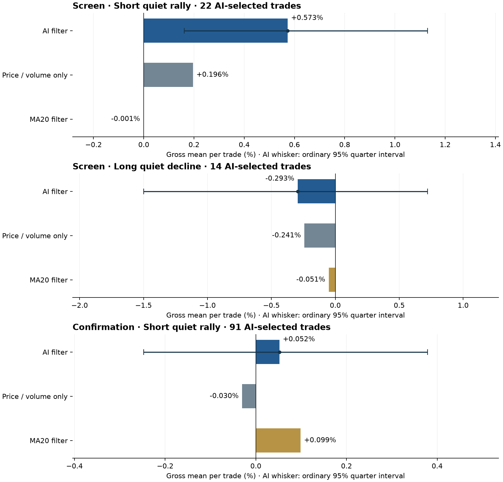

# Countermind

Independent research and hobby project by [Ekin-Akcay](https://github.com/Ekin-Akcay): can an AI trading decision add useful information to a trading strategy—whether followed, reversed, or combined with price and volume indicators?

The original hypothesis was that models might reproduce common retail-trader mistakes. The experiments test that idea rather than assume it is true. **No reliable AI-dependent trading edge has been established in the completed studies.** Failed experiments and controls are included alongside promising exploratory results.

## How the experiments work

Models receive an anonymized candlestick chart and numerical market data. Prices are rebased, historical dates and asset identities are hidden, and model opinions are collected in isolated contexts. Decisions are then evaluated against historical minute candles. Experiments include fixed reward/risk geometry, moving-average ablation, reversing decisions, delayed entries, alternative exits, and price/volume controls.

Later studies distinguish screening from separate confirmation samples and examine entire price paths, not only stop-loss/take-profit hits. Historical masking does not guarantee that prices were unknown during model training. Repeated search, shared market regimes, conditional sampling and outliers limit the strength of conclusions.

## Latest completed study — September 30, 2026

The latest study collected **180 new isolated Terra opinions**: 60 screening windows across two hypotheses, followed by 120 confirmation windows for the passing short hypothesis. The tested policy waits for a 30-minute quiet countermove after the AI decision, then holds for 120 minutes.

| Test | AI-selected trades | Mean gross return per trade |
|---|---:|---:|
| Short after quiet rally — screen | 22 | +0.573% |
| Short after quiet rally — confirmation | 91 | +0.052% |
| Long after quiet decline — screen | 14 | −0.293% |

**The short hypothesis failed confirmation.** Its confirmation win rate was 46.2%; removing its largest winner made the mean negative. The ordinary quarter-bootstrap 95% interval for the mean was −0.248% to +0.379%. The later chronological half lost money. These are gross, unleveraged returns, not net account returns.

A separate, explicitly retrospective comparison used identical trade coverage: following every AI direction averaged +0.109%, versus +0.157% for following MA20 direction. Both estimates were uncertain. AI agreed with MA20 direction in 80% of confirmation cases; original confidence was almost identical among selected winners and losers.

- [Full latest findings](data/analysis/ai-timing-200-20260930/RESULTS.md)
- [Interactive report with all 180 decisions and price paths](data/analysis/ai-timing-200-20260930/index.html) — download/clone and open locally
- [Frozen protocol](data/analysis/ai-timing-200-20260930/VALIDATION_PROTOCOL.md)
- [AI reasons and trade-path examples](data/analysis/ai-timing-200-20260930/interpretation/AI_BEHAVIOR.md)
- [Comparison at identical trade coverage](data/analysis/ai-timing-200-20260930/interpretation/IDENTICAL_COVERAGE.md)
- [Joined decisions and outcomes](data/sim/ai-timing-200-20260930T104240Z/decisions_with_outcomes.jsonl)



## Research history

| Study | Record |
|---|---|
| Original thesis and experiment design | [Research thesis](docs/00-thesis.md), [experiment registry](docs/02-experiments.md), [simulation design](docs/05-simulation.md) |
| Directional bias and forward paths | [Findings](data/analysis/direction-paths-20260929/FINDINGS.md) |
| Alternative exits | [Findings](data/analysis/exit-policies-20260929/FINDINGS.md) |
| Long recovery | [Findings](data/analysis/long-recovery-20260929/FINDINGS.md) |
| Reversal research and validation | [Results](data/analysis/reversal-deep-20260929/RESULTS.md) |
| Expanded validation and MA intervention | [Results](data/analysis/gross-edge-20260929/RESULTS.md), [MA study](data/analysis/gross-edge-20260929/ma_ablation/RESULTS.md) |
| Relative value, model surprises, target exhaustion | [Results](data/analysis/new-angles-20260930/RESULTS.md) |
| Same-moment volume, path and exit patterns | [Results](data/analysis/same-moment-patterns-20260930/RESULTS.md) |
| Fresh AI timing experiment | [Results](data/analysis/ai-timing-200-20260930/RESULTS.md) |

Older documents are historical research records. A positive exploratory result in an earlier report does not supersede a later failed validation. Historical model names, deployment identifiers and cutoff assumptions are preserved as recorded; they are not a current model recommendation.

## Reproduce the published result

```bash
python3 -m venv .venv
.venv/bin/python -m pip install -r requirements.txt
.venv/bin/python -m pytest -q
.venv/bin/python scripts/reproduce_published_results.py
```

The last command makes **no model calls and no network requests**. It checks the latest 180 trade returns against the included minute paths and reproduces the screening/confirmation summaries and 40,000 quarter-bootstrap draws. It also checks the retrospective equal-coverage comparison. A numerical success means the reported calculations reproduce; it does not mean the strategy passed its economic criteria.

For charts and interactive reports, open `data/analysis/ai-timing-200-20260930/index.html` in a browser after cloning. GitHub displays HTML source rather than running the interactive report.

## Repository layout

- `src/nai/`, `scripts/`, `tests/`: data retrieval, snapshot generation, model adapters, simulation and evaluation code.
- `configs/`: asset universe and model configuration; paid model adapters are disabled by default.
- `docs/`: thesis, background, experiment designs and leakage rules.
- `data/sim/`: published opinions, anonymous inputs, outcome ledgers and historical reports.
- `data/analysis/`: research scripts, sampled windows, results, path arrays, plots and audit summaries.
- `data/research/`: earlier hypothesis notes.

Raw vendor archives, credentials, local session transcripts, operational budget files and machine-specific state are excluded. [PUBLICATION.md](PUBLICATION.md) explains sanitization, provenance and reproduction limits. [PUBLICATION_MANIFEST.json](PUBLICATION_MANIFEST.json) maps original artifact hashes to public export hashes. [CONTINUING_RESEARCH.md](CONTINUING_RESEARCH.md) records where the research stopped.

AI assistants helped implement the research, collect model decisions and analyze results. Nothing in this repository places live orders. This is experimental research, not an investment recommendation.
