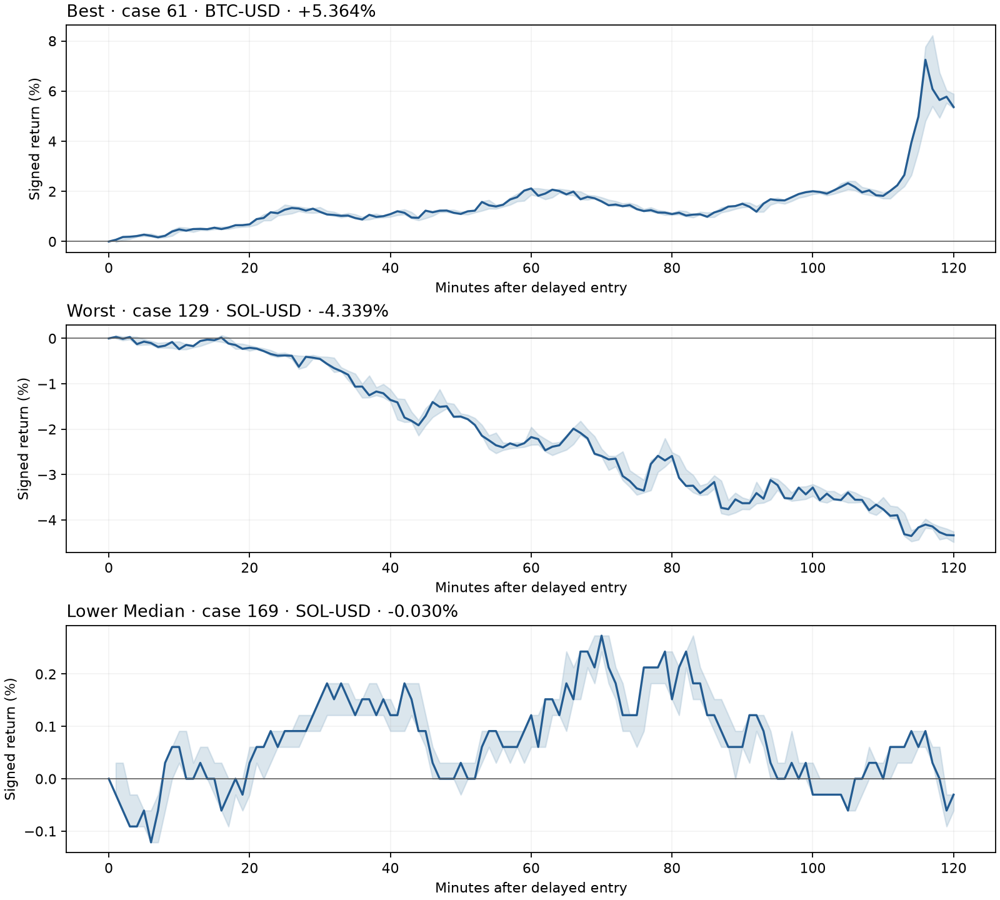

# What the AI said and how the positions moved

This is a descriptive review of completed screening and confirmation trades. It changes no trading rule and adds no statistical test. Screening and confirmation are shown separately; the frozen confirmation verdict remains authoritative. Returns are gross, with zero fees, funding and leverage.

The AI saw the snapshot at t0. It did not see the following 30-minute move or volume gate; the evaluated policy enters at t0+30 and closes after 120 minutes. This review therefore describes the delayed policy, not the outcome of the original AI bracket.

The clearest descriptive finding is action agreement with moving averages: 96/120 confirmation opinions agreed with MA20 direction and 93/120 with MA50 direction. When the original price was below both averages, 54/54 calls were short; above both, 24/33 were long. This does not establish that the model used the averages rather than correlated price structure.

Confidence barely differed between selected winners and losers in this sample: means 0.591 and 0.590, with medians 0.58 and 0.58. The best and worst declared-rank examples both described weak rebounds below moving averages, yet their delayed shorts ended at opposite extremes. Similar wording is therefore not a reliable explanation of why these individual outcomes differed.

The observed first 30-minute move runs against the selected AI direction by construction. It is not evidence that the AI is statistically wrong. Later winning/losing path differences are also outcome-conditioned descriptions, not tested entry or exit rules.

## Action, moving averages, and confidence

MA agreement means long above/equal to the original moving average and short below it. Agreement is an association; it does not identify what caused the decision. Confidence is self-reported and is not treated as a win probability.

| Stage / gate | Opinions | AI long / short | MA20 agreement | MA50 agreement | Selected / opposed confidence median |
|---|---:|---:|---:|---:|---:|
| screen / down | 30 | 14 / 16 | 19/30 | 24/30 | 0.575 / 0.57 |
| screen / up | 30 | 8 / 22 | 22/30 | 24/30 | 0.58 / 0.565 |
| confirmation / up | 120 | 29 / 91 | 96/120 | 93/120 | 0.58 / 0.56 |

Full MA cross-tabs, asset counts, confidence means, ranges and interquartile ranges are retained in `behavior.json`. The gates are selected populations, so these agreement rates are not estimates over all market times.

## Wording and position paths

Reason categories use the exact literal substring dictionary in PLAN.md. They overlap and summarize language; a mention does not prove causal reasoning. This deliberately literal dictionary can miss variants such as the bare word “averages”, so category counts are not exhaustive semantic counts. Winning/losing groups below are defined from the eventual outcome and cannot be used as entry signals.

### screen: down gate

| Selected group | n | Confidence median | 15m return median | 30m | 60m | 120m | MFE median | MAE median |
|---|---:|---:|---:|---:|---:|---:|---:|---:|
| selected_winners | 5 | 0.58 | +0.067% | +0.132% | +0.041% | +0.248% | +0.433% | -0.114% |
| selected_losers | 9 | 0.57 | -0.020% | -0.007% | -0.060% | -0.308% | +0.217% | -0.791% |

| Reason category | All calls | Selected winners | Selected losers |
|---|---:|---:|---:|
| moving_averages | 19 | 4 | 6 |
| continuation_trend | 11 | 3 | 3 |
| exhaustion_reversal | 5 | 0 | 0 |
| breakout_rejection | 8 | 1 | 4 |
| levels | 20 | 2 | 4 |
| volume | 20 | 2 | 4 |

### screen: up gate

| Selected group | n | Confidence median | 15m return median | 30m | 60m | 120m | MFE median | MAE median |
|---|---:|---:|---:|---:|---:|---:|---:|---:|
| selected_winners | 17 | 0.58 | +0.080% | +0.116% | +0.261% | +0.605% | +0.813% | -0.180% |
| selected_losers | 5 | 0.59 | +0.038% | +0.131% | -0.008% | -0.619% | +0.361% | -0.713% |

| Reason category | All calls | Selected winners | Selected losers |
|---|---:|---:|---:|
| moving_averages | 20 | 13 | 3 |
| continuation_trend | 15 | 8 | 2 |
| exhaustion_reversal | 8 | 5 | 1 |
| breakout_rejection | 10 | 8 | 2 |
| levels | 14 | 6 | 3 |
| volume | 16 | 9 | 2 |

### confirmation: up gate

| Selected group | n | Confidence median | 15m return median | 30m | 60m | 120m | MFE median | MAE median |
|---|---:|---:|---:|---:|---:|---:|---:|---:|
| selected_winners | 42 | 0.58 | +0.049% | +0.126% | +0.157% | +0.359% | +0.937% | -0.248% |
| selected_losers | 49 | 0.58 | +0.000% | -0.011% | -0.174% | -0.266% | +0.188% | -0.558% |

| Reason category | All calls | Selected winners | Selected losers |
|---|---:|---:|---:|
| moving_averages | 70 | 25 | 29 |
| continuation_trend | 62 | 23 | 22 |
| exhaustion_reversal | 46 | 17 | 25 |
| breakout_rejection | 45 | 13 | 24 |
| levels | 62 | 23 | 21 |
| volume | 87 | 32 | 37 |

## Three declared-rank confirmation examples

Examples are the best, worst and lower-median selected confirmation returns, chosen by the rule written before confirmation outcomes were opened. Extremes are exceptional observations, not representative estimates. Intrabar high/low order is unknown.

### best: case 61, BTC-USD

Original AI: **short**, confidence 0.61. Original price was below MA20 and below MA50.

> Downtrend below declining averages; weak bounce and fading volume favor retest lower.

The first 30 minutes moved +0.622%, with volume ratio 0.728. Delayed short entry: 2021-12-04 03:00:00 UTC at 53128.59; exit: 2021-12-04 05:00:00 UTC at 50278.8.
Signed returns at 15/30/60/120 minutes: +0.551% / +1.185% / +2.117% / **+5.364%**. MFE +8.217% first reached in minute 117; MAE -0.028% first reached in minute 1.

### worst: case 129, SOL-USD

Original AI: **short**, confidence 0.57. Original price was below MA20 and below MA50.

> Price below both averages; weak rebound and current bearish close favor downside.

The first 30 minutes moved +0.430%, with volume ratio 0.544. Delayed short entry: 2023-11-06 22:00:00 UTC at 40.427; exit: 2023-11-07 00:00:00 UTC at 42.181.
Signed returns at 15/30/60/120 minutes: -0.040% / -0.453% / -2.174% / **-4.339%**. MFE +0.067% first reached in minute 16; MAE -4.487% first reached in minute 120.

### lower median: case 169, SOL-USD

Original AI: **short**, confidence 0.56. Original price was above/equal to MA20 and below MA50.

> Below MA50 after weak rebound; recent lower highs favor retest of support.

The first 30 minutes moved +0.122%, with volume ratio 0.374. Delayed short entry: 2022-10-08 10:00:00 UTC at 32.93; exit: 2022-10-08 12:00:00 UTC at 32.94.
Signed returns at 15/30/60/120 minutes: -0.000% / +0.152% / +0.121% / **-0.030%**. MFE +0.273% first reached in minute 69; MAE -0.121% first reached in minute 6.

## Limits

These descriptive differences cannot rescue a failed confirmation criterion, establish that moving averages caused the calls, or show that the AI acts like a losing retail trader. The rationale is a short self-reported explanation. Asset and calendar composition can explain apparent differences between winning and losing groups. No new threshold, model, exit or direction rule was selected from this review.
