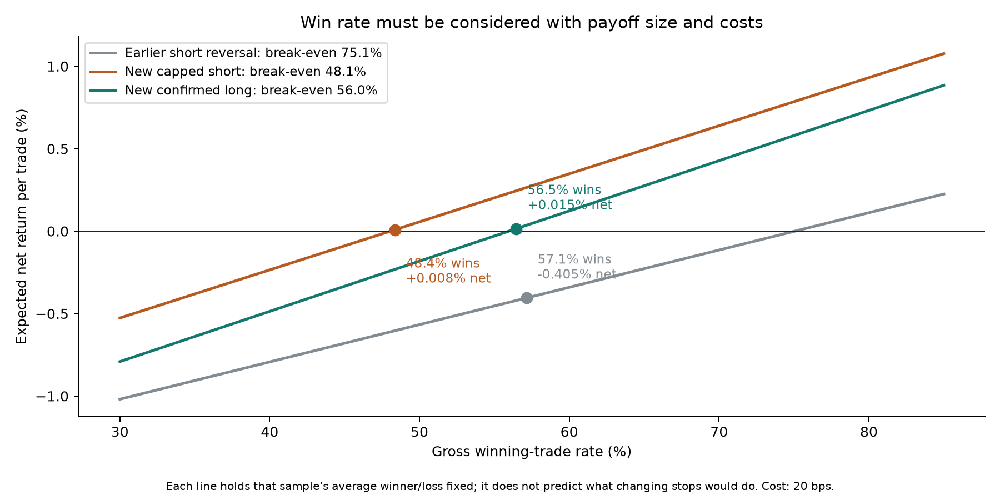

# Positive backtests found; no reliably profitable AI-reversal strategy verified

The investigation collected **280 additional isolated Terra snapshots** and tested the two chosen rules on all 280 before any outcome-driven revision. Both had small positive net averages, but neither passed the locked verification criteria. Continued exploratory work retained **11,295 strategy/control definitions** (9,336 unique return vectors). None passed the complete-family, calendar-quarter search correction. The user-authorized limit is300 physical calls;280 were used, with no retries. No actual financial trades were placed.

## What the win rate means

The earlier short strategy won 57.1% of trades, averaging+0.764% on winners and−1.498% on losers. Its payoff distribution required 75.1% wins to break even after 20 bps. A stop changes which trades win; it cannot merely clip final losses while preserving all winners.

The new capped-short rule improved the payout distribution, but its 48.4% win rate was only slightly above its 48.1% estimated break-even rate. The confirmed-long rule won 56.5% versus a 56.0% break-even rate. This is why both newer backtests were barely positive after costs despite better trade construction.

## Frozen test on280 new windows

| Rule | Executions | Gross-positive | Mean gross/trade | Mean net at 20 bps | Simultaneous net interval |
|---|---:|---:|---:|---:|---|
| L: AI SHORT → positive 15m confirmation → LONG 240m |85|48/85 (56.5%)|+0.2151%|**+0.0151%**|−0.5485% to+0.5718%|
| S: AI LONG → SHORT, 1.5× AI stop, 2× risk target, 240m cap |91|44/91 (48.4%)|+0.2082%|**+0.0082%**|−0.4018% to+0.4363%|

L net at 30 bps is−0.0849%; S is−0.0918%. Five-minute entry delay leaves L+0.0478% net but turns S to−0.1287%. Removing the largest winner turns either rule's net mean negative. No compounded or leveraged portfolio return is claimed.

AI contribution was tested separately by permuting decisions within pre-entry MA regimes and broad calendar eras. S moved action and stop/ATR ratio jointly while retaining the receiving window's volatility. Adjusted p-values: **L 0.2911; S 0.0627**. S's raw p=0.0313 is an interesting exploratory lead, but it did not pass the two-test correction. Positive historical averages are not the same as evidence of positive expected profits.

## How far the search went

- Initial discovery:824 risk/exit geometries,116 entry/filter candidates,108 invalidation policies, all retained on the existing 150 Terra windows.
- Expanded replay:721 within-24h risk geometries across 15 direction/regime/benchmark configurations, plus the declared signal and invalidation families and controls.
- BTC hedging: fixed 0.5/1.0 and trailing-beta hedges, both notional conventions. Every nonzero hedge lost in the fresh sample. L's net moved from+0.0151% unhedged to−0.1517% with half-notional BTC and−0.5433% with the estimated beta hedge.
- Stop-out fades: wait for the original AI bracket to stop first, then enter its original direction at the following minute open. All 16 policies lost in the old sample. Two had positive newer means, but were unstable; the best+0.4839% newer result became negative after removing three winners and had−0.3374% in the old sample.

The complete retrospective family includes11,295 definitions, not 11,295 independent experiments. Shared outcomes and calendar dependence are preserved in 20,000 joint quarter resamples. Largest observed t=1.8765 ; 95% family critical t=3.8466; global adjusted p=0.97745. **Zero policies pass.** The original failed primary tests stay unchanged; expanded results are not relabeled as untouched validation.

## Strongest remaining long lead — unverified

When Terra predicts SHORT and the previous completed daily SOL close is below its 50-day average and BTC below its 200-day average, immediately buy and hold 240 minutes. This post-selection lead had65 fresh trades averaging **+0.5351% gross /+0.3351% net**, versus only+0.0116% net on 22 old trades. Its newest chronological third averaged−0.0419%; its unadjusted 95% interval already includes losses. The full-search adjusted p is0.97745. It is a research hypothesis, not a verified strategy.

## What has been verified

All 280 decisions used fresh sessions, the exact anonymized inputs, the chosen model and no tools. Every input/source hash was checked. Independent implementations replayed primary entries/exits, 78,400 donor brackets, 40,000 conditional permutation results, and both bootstrap families. Additional independent checks covered the full search matrix, hedges and stop-out logic. Every old ledger/report/source file in the preservation manifest remains unchanged.

The archive is historical SOL data, with BTC only as a macro variable or hedge. New windows are unused in these experiments and have disjoint prescribed histories/evaluation intervals; they are not a live or chronological future holdout, and anonymization cannot guarantee absence from model training. Fixed 20 bps costs omit funding, borrow and market impact. Original-close S entry ignores model latency; delay sensitivities are shown.

## Budget and conclusion

The remaining 20 calls were not spent merely to fill the limit. At the strongest long lead's 23% trigger rate, 20 random calls would produce roughly five trades—too few to establish a modest edge. Pooling an extra batch until a p-value turns favorable would not be valid confirmation.

There are positive calculated returns here, and the central data/implementation checks passed. **There is no verified reliable profit opportunity from the tested AI-reversal idea yet.** More parameter search on these same outcomes cannot be treated as new evidence. The strategy objective remains unmet; this report records the completed bounded investigation rather than claiming a profitable system was found.

- [Complete primary trade-by-trade report](../../sim/reversal-validation280-20260929T194012Z/index.html)
- [All 280 windows, including skips and controls](../../sim/reversal-validation280-20260929T194012Z/window_results.csv)
- [Every executed primary trade](../../sim/reversal-validation280-20260929T194012Z/strategy_trades.csv)
- [All 11,295 search results](search_correction/all_family_results.csv)
- [Frozen primary protocol](VALIDATION_PROTOCOL.md)
- [Primary statistical audit](design/validation_final_statistics_audit.json)
- [Full-family statistical audit](design/expanded_familywise_audit.json)
- [Risk discovery and replay](risk/fresh_grid/FINDINGS.md)
- [Signal discovery and replay](signals/fresh_grid/FINDINGS.md)
- [Hedge study](risk/hedge_study/FINDINGS.md)
- [Stop-out fade study](signals/stopout_fade/FINDINGS.md)

Search-history and untouched-validation separation follow the concern described in [Bailey et al., The Probability of Backtest Overfitting](https://www.davidhbailey.com/dhbpapers/backtest-prob.pdf). The reported returns and tests are calculated from this project's files, not that paper.
